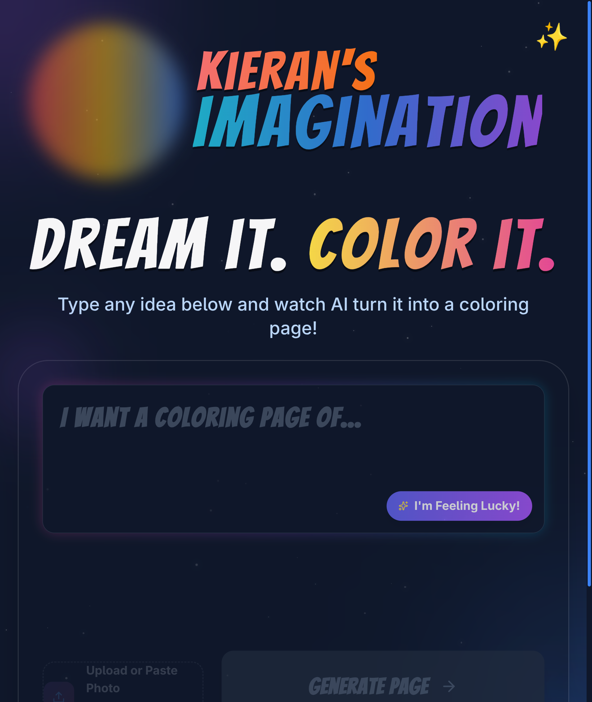

# Kieran's Imagination

Kieran's Imagination is a creation-first coloring-page and trading-card app for kids and families. Describe an idea, optionally add a photo, and start creating immediately. Work is saved automatically in **My creations** without asking children to set up projects or organize folders first.

Live site: [kieran.app](https://kieran.app)



## What it does

- Generates printable coloring pages from prompts and photos
- Improves ideas and supplies kid-friendly prompt suggestions
- Saves creations and revision history automatically
- Supports AI edits, canvas edits, downloads, and sharing
- Builds structured trading cards whose text and frame stay editable
- Runs creation as durable jobs that survive refreshes
- Normalizes generated and uploaded media into R2 assets

## Architecture

```text
React 19 + Vite
  -> Cloudflare Worker + Static Assets
      -> Creation Jobs on Cloudflare Workflows
          -> one Creation Engine
              -> Google Gemini adapter
      -> Cloudflare Images normalization
      -> R2 media assets
      -> D1 jobs, budgets, creations, revisions, and card documents
```

All production image generation and editing use `gemini-3.1-flash-lite-image` at 1K through `server/creation/google.ts`; structured text uses `gemini-3.1-flash-lite`. Larger models are intentionally absent from the production catalog. A future experiment with another model must be an explicit dev/admin-only path and must not appear as a normal user quality choice.

The database retains an internal `imagination_worlds` collection boundary, but the product does not expose Worlds. The frontend silently reuses or creates a default collection and presents the result as **My creations**.

Key paths:

- `App.tsx` — React Router shell and compatibility redirects
- `components/CreatorHome.tsx` — prompt-first home and creation flow
- `components/CreationsLibrary.tsx` — saved coloring pages and cards
- `components/worlds/ArtworkView.tsx` — durable artwork and revision view
- `components/cards/` — card document editor and renderer
- `server/creation/` — engine, profiles, prompts, and single Gemini adapter
- `worker/` — Worker router, auth, jobs, uploads, and Workflow
- `server/media/` — normalization and media persistence
- `migrations/` — D1 schema migrations

## Local development

```bash
bun install
bun run db:migrate:local
bun run dev
```

Create `.dev.vars` with Worker-only secrets:

```text
GEMINI_API_KEY=your_api_key_here
FAMILY_ACCESS_CODE=your_family_code
SESSION_SIGNING_KEY=your_random_signing_key
```

The Gemini key is never exposed to the Vite client.

Validation:

```bash
bun run check
```

## Cloudflare resources

| Binding | Type | Purpose |
|---|---|---|
| `ASSETS` | Static Assets | Serve the built SPA |
| `IMAGES_BUCKET` | R2 | Store immutable media bytes |
| `DB` | D1 | Store jobs, budgets, creations, revisions, cards, and legacy votes |
| `IMAGES` | Images | Normalize and transform media |
| `CREATION_WORKFLOW` | Workflow | Execute durable creation jobs |
| `APP_RATE_LIMITER` | Rate limit | Protect login and job submission |

## API surface

| Endpoint | Method | Description |
|---|---|---|
| `/api/uploads` | POST | Normalize an uploaded image and return an asset ID |
| `/api/jobs` | POST | Submit an idempotent creation request |
| `/api/jobs/:id` | GET | Read durable job status and result |
| `/api/assets/:id` | GET | Stream an authorized media asset |
| `/api/worlds` | GET/POST | Internal saved-creation collection API |
| `/api/artworks/:id` | GET | Read artwork and revision history |
| `/api/cards/:id` | GET/PATCH | Read or update a structured card document |
| `/api/suggestions` | GET | Get prompt suggestions |

## Deployment

```bash
bun run build
npx wrangler d1 migrations apply kieran-db --remote
npx wrangler deploy
```

Do not recreate or maintain Pages Functions creation APIs alongside the Worker.
